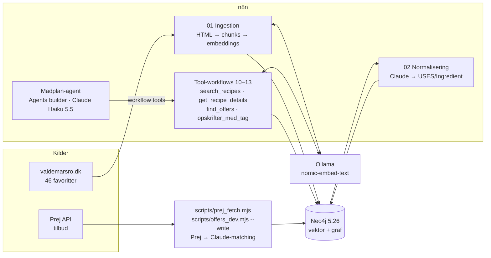

# Bisgaard_Madplan · madplan-agent med RAG i Neo4j (vektor + graf)

> Midtvejsprojekt (RAG) i **AI-agenter og automatisering**, EK – IT-arkitektur, 5. semester, efterår 2026. Jacob Bisgaard.

## Case og agentens rolle

**Case:** En agent, der laver madplaner ud fra mine egne 46 favoritopskrifter fra valdemarsro.dk og prioriterer retter, hvis ingredienser er på tilbud i Rema 1000, Netto og SuperBrugsen (via Prej API).

**Rolle:** *Personlig madplanlægger og indkøbsrådgiver.* Agenten finder retter ud fra stemning og krav, laver ugeplaner (som udgangspunkt én vegetardag), viser hvilke ingredienser der er på tilbud og anbefaler **én** butik – en ekstra butik kun ved mindst 50 kr. ekstra besparelse ("vi kører ikke i Netto for at spare 3 kr. på en pose løg"). Den linker altid til originalopskriften i stedet for at gengive fremgangsmåden.

**Hvorfor både vektor og graf:**

| | Bruges til | Eksempel |
|---|---|---|
| **Vektor** (chunks + `nomic-embed-text`) | Betydning/stemning, som ikke står som data | "noget cremet med kylling", "en varm suppe" |
| **Graf** (opskrift → tags, ingredienser → produkter på tilbud → kæder) | Præcise fakta og relationer | "alle vegetarretter", "hvad er på tilbud i mine retter", "hvor skal jeg handle" |
| **Hybrid** (én Cypher-query) | Vektorscore + filtre på tid/tags + antal ingredienser på tilbud | madplanen i eksempel E3 |

Test viste, hvorfor begge dele er nødvendige: "noget sundt og hurtigt" gav flade, meningsløse vektorscorer (Millionbøf øverst), mens tidsfilter + tags fra grafen gav Tex Mex Salat og Bønnegryde (`docs/retrieval-tests.md`).

## Arkitektur



| Komponent | Kører | Rolle |
|---|---|---|
| **Neo4j 5.26** (community, APOC) | Docker (`docker-compose.yml`), netværk `madplan` | Én database til både vektor-index og graf |
| **n8n 2.45.4** | Docker | Ingestion-workflows, tool-workflows og agenten (Agents builder) |
| **Ollama** | Native på Mac | `nomic-embed-text` (768 dim) til embeddings af chunks og spørgsmål |
| **Claude Haiku 5.5** | Anthropic API | Agentens model + LLM-trin i normalisering og tilbudsmatchning |
| **Prej API** (gratis plan, 25 kald/døgn) | – | Ugens tilbud for Rema 1000, Netto, SuperBrugsen |

**Modelvalg:** Lokale modeller (qwen2.5/qwen3 via Ollama) kunne godt kalde tools i Agents builder, men krævede workarounds (ingen Ollama-provider, `item_reference`-fejl med thinking-modeller) og er usikre ved komplekse opgaver. Underviseren bekræftede, at store modeller er fint, så agenten kører på Claude Haiku 5.5 (hele projektet har kostet under 1 kr. i API). Fejlsøgningen er dokumenteret i `docs/agents-builder-ollama.md`.

## Hvor finder jeg hvad (afleveringskrav)

| Krav | Placering |
|---|---|
| README (case, rolle, sammenhæng) | denne fil |
| **Screenshots af workflows** (samme nummer som workflow-filen; formål i tabellen) | `docs/screenshots/` – oversigt over alle 6 workflows i n8n: `00_oversigt.png`; hvert workflow: se tabellen *Workflows og tools* nedenfor |
| **Workflow-JSON** | `n8n/` (6 workflows) |
| **Agent-konfiguration**: model, instruktioner, tool-beskrivelser (ingen skills) | `agent/instructions.md`, `agent/tools.md` |
| Screenshots af agenten og dens tool-forbindelser | `docs/screenshots/agent_model.png`, `docs/screenshots/agent_tools.png` |
| **Prompts brugt under udviklingen** | `prompts/` (00 projektinstruktioner, 01 startprompt med resultat, 02 prompts i pipelinen og vigtige udviklingsprompts), `docs/agent-test-prompts.md` |
| **3 eksempelspørgsmål** (tool-kald, hentet info, svar, vurdering, fejl) | `docs/eksempler.md` + rå tool-kald i `docs/eksempler/` + `docs/screenshots/E1_*.png`, `E2_*.png` |
| **Data og setup** (kilder, sample, noder, relationer, properties, genskabelse) | afsnittene *Datamodel*, *Data* og *Genskab setup og data* nedenfor + `data/sample/` |
| AI til grafmodel, normalisering og Cypher | `docs/graf-model-og-ai.md` |
| Evalueringer og beslutninger | `docs/normalisering-evaluering.md`, `docs/retrieval-tests.md`, `docs/beslutninger.md`, `docs/agents-builder-ollama.md` |

## Workflows og tools

| Workflow (`n8n/`) | Formål | Screenshot (`docs/screenshots/`) |
|---|---|---|
| `01_ingest_opskrifter.json` | **Data-ingestion (vektor + graf):** henter favoritterne (3 sek. pause, ærlig User-Agent), udtrækker schema.org-microdata, deler hver opskrift i chunks (profil, ingredienser, tips, fremgangsmåde), embedder med Ollama og skriver graf + vektor til Neo4j i **én transaktion** | `01_ingestion.png` |
| `02_normaliser_ingredienser.json` | **Graf-normalisering med AI:** Claude laver 847 rå ingredienslinjer om til `(Recipe)-[:USES]->(Ingredient)`, finder synonymer, og en deterministisk kontrol afviser forkerte sammenlægninger | `02_normalisering.png` |
| `10_tool_opskrifter_med_tag.json` | **Graf-retrieval:** alle opskrifter med et tag / liste over tags | `10_tool_opskrifter_med_tag.png` |
| `11_tool_search_recipes.json` | **Vektor-retrieval (hybrid):** embedder spørgsmålet, vektorsøgning på chunks samlet pr. opskrift + filtre på tid/tags + tilbud i samme Cypher-query | `11_tool_search_recipes.png` |
| `12_tool_get_recipe_details.json` | **Graf-retrieval:** kategori, tags, ingredienser, tid, holdbarhed, tips, relaterede opskrifter | `12_tool_get_recipe_details.png` |
| `13_tool_find_offers.json` | **Graf-retrieval (tilbud):** ingredienser på tilbud pr. kæde, samlet besparelse og anbefaling af én butik | `13_tool_find_offers.png` |

Hvert tool-workflow starter med *When Executed by Another Workflow* (input som beskrevet i `agent/tools.md`) og returnerer data **med kilde** (opskrifts-url, tilbudsperiode, hvilken Cypher-relation der er brugt).

**Scripts** (`scripts/`):

| Script | Formål |
|---|---|
| `01_neo4j_op.sh` | Starter Neo4j, forbinder n8n til netværket `madplan`, kører schema og indexes |
| `prej_fetch.mjs` | Henter ugens tilbud fra Prej (cache i `data/raw/prej/`, maks. 25 kald/døgn) |
| `offers_dev.mjs --write` | Claude kobler produkter til ingredienser og skriver `Product`, `ON_OFFER`, `IS_A` til Neo4j |
| `hent_sider.mjs` | Cacher opskriftssiderne lokalt til parsing-testen (`npm test`) |
| `normalize_dev.mjs` | Tester/evaluerer normaliseringsprompten uden n8n |
| `test_tools.mjs`, `vektorsoeg.mjs` | Tester tool-workflowenes Cypher og vektorsøgningen uden n8n |
| `export_sample.mjs` | Eksporterer datasample og statistik til `data/sample/` |
| `cypher.sh`, `00_status.sh` | Kør Cypher mod Neo4j · statustjek af Docker/n8n/Ollama |
| `ollama-eksperiment/` | Proxy og test fra forsøget med lokale modeller i Agents builder (ikke del af den færdige løsning – se `docs/agents-builder-ollama.md`) |

Alle workflows **genereres fra kildekode** i `src/` (`npm run build`), så logikken kan testes uden n8n (`npm test`, `npm run test:tools`, `node scripts/normalize_dev.mjs`).

## Datamodel

```
(Chunk)-[:CHUNK_OF]->(Recipe)-[:IN_CATEGORY]->(Category)
                     (Recipe)-[:HAS_TAG]->(Tag)
                     (Recipe)-[:SEE_ALSO]->(Recipe)            "Prøv også" (kun mellem favoritter)
                     (Recipe)-[:SERVED_WITH]->(Recipe)         "Forslag til servering"
                     (Recipe)-[:USES {amount, unit, …}]->(Ingredient)<-[:IS_A]-(Product)-[:ON_OFFER {price, …}]->(Chain)
```

**Noder**

| Label | Nøgle | Egenskaber | Kilde |
|---|---|---|---|
| `Recipe` | `url` | title, description (kun intro), servings, totalMinutes, cookMinutes, shelfLife, freezable, tips[], image, ingredientLines[], ingredientSections[], serveWith[], seeAlso[], source, ingestedAt | valdemarsro.dk (workflow 01) |
| `Chunk` | `id` (`url#type`) | type (profil / ingredienser / tips / fremgangsmaade[-n]), text, source, recipeTitle, embeddingModel, **embedding** (768 floats) | workflow 01 |
| `Category` | `name` | fx "Aftensmad" | schema.org `recipeCategory` |
| `Tag` | `name` | fx "Vegetar", "Nem Hverdagsmad" | schema.org `keywords` |
| `Ingredient` | `name` | name (dansk, ental, normaliseret), pantry (basisvare), normalizedBy, normalizedAt | workflow 02 (Claude) |
| `Product` | `id` (Prej product_id) | name, brand, quantity, unit, quantityLabel | Prej API |
| `Chain` | `slug` | name | Prej API |

**Relationer**

| Type | Egenskaber | Betydning |
|---|---|---|
| `CHUNK_OF` | – | tekststykke tilhører opskrift (vektor ↔ graf) |
| `IN_CATEGORY`, `HAS_TAG` | – | kategori og tags fra kilden |
| `SEE_ALSO`, `SERVED_WITH` | – | opskrifter der henviser til hinanden |
| `USES` | line, amount, unit, prep, optional, section, raw | opskrift bruger ingrediens (den rå linje bevares) |
| `IS_A` | matchedBy, matchedAt | produkt kan købes som ingrediensen (Claude-match) |
| `ON_OFFER` | price, normalPrice (øre), discountPct, validFrom, validTo, source, asOf, fetchedAt | produkt på tilbud i kæde; udløbne ignoreres (`validTo >= date()`) |

**Indexes** (`neo4j/01_schema.cypher`): unikke constraints på Recipe.url, Category.name, Tag.name, Ingredient.name, Chunk.id, Chain.slug, Product.id · **vector index `chunk_embedding`** (768 dim, cosine) · fulltext index `recipe_text` (titel + beskrivelse).

**Omfang (2/11):**

| Noder | Antal | | Relationer | Antal |
|---|---|---|---|---|
| Recipe | 46 | | USES | 918 |
| Chunk | 188 | | ON_OFFER | 509 |
| Ingredient | 183 (47 basisvarer) | | HAS_TAG | 208 |
| Tag | 37 | | CHUNK_OF | 188 |
| Category | 2 | | IN_CATEGORY | 46 |
| Product | 505 | | SEE_ALSO | 45 |
| Chain | 3 | | IS_A | 41 |

(`SERVED_WITH` er 0: serveringsforslagene er brød/tilbehør, der ikke er blandt favoritterne. Kilde: `data/sample/graf_statistik.json`.)

## Data

- **Opskrifter:** 46 håndplukkede favoritter fra valdemarsro.dk (`data/favoritter.txt`). Intet API – siderne har schema.org-microdata. Hentet høfligt (3 sek. pause, ærlig User-Agent; robots.txt tillader det). **Fuld opskriftstekst ligger kun i den lokale database** – repoet indeholder kun titel, url, tags og ingredienser, og agenten linker altid til originalen.
- **Tilbud:** Prej API `/v1/offers` (gratis plan, ikke-kommerciel brug). Priser i øre, `offer_ends` inklusiv.
- **Sample:** `data/sample/opskrifter_sample.json` (5 opskrifter med normaliserede ingredienser), `data/sample/tilbud_sample.json` (tilbud på udvalgte ingredienser), `data/sample/graf_statistik.json`.

## Genskab setup og data

Krav: Docker Desktop, Node 24, Ollama (`ollama pull nomic-embed-text`), n8n ≥ 2.32.3 (testet på 2.45.4; i n8n's compose: `N8N_ENABLED_MODULES=agents` og netværket `madplan`), Anthropic API-nøgle, gratis Prej-nøgle.

```bash
cp .env.example .env              # NEO4J_PASSWORD, PREJ_API_KEY, ANTHROPIC_API_KEY
npm install                       # cheerio til parsing-test
bash scripts/01_neo4j_op.sh       # starter Neo4j, forbinder n8n til netværket madplan, kører schema + indexes
```

1. **n8n credentials:** Basic Auth `Neo4j lokal` (neo4j / din adgangskode) og Anthropic. Ret credential-id'erne øverst i `src/build_*.js` og kør `npm run build` – eller vælg credentials i noderne efter import.
2. **Opskrifter:** importér `n8n/01_ingest_opskrifter.json` → Execute. Tjek: `bash scripts/cypher.sh < neo4j/10_kontrol.cypher`.
3. **Ingredienser:** importér `n8n/02_normaliser_ingredienser.json` → Execute. Tjek: `bash scripts/cypher.sh < neo4j/11_kontrol_ingredienser.cypher`.
4. **Tilbud:** `node scripts/prej_fetch.mjs` (≈ 7 kald) og `node scripts/offers_dev.mjs --write`.
5. **Tools:** importér og **udgiv** `n8n/10–13_tool_*.json`.
6. **Agent:** n8n → Personal → Agents → Create Agent. Model: Anthropic → Claude Haiku 5.5. Instructions fra `agent/instructions.md`. Capabilities → Workflows: de fire tools med beskrivelserne fra `agent/tools.md`.

Nulstil data: `bash scripts/cypher.sh < neo4j/99_reset.cypher` (beholder constraints og indexes).

## Brug af AI og prompt-log

Projektet er udviklet sammen med Claude (Claude Code / Cowork). AI blev brugt til at **foreslå grafmodellen**, til at **normalisere noderne** i selve workflowet (ingredienser, synonymer, produktmatch), til at **skrive Cypher og workflows**, og som **agentens model** – se `docs/graf-model-og-ai.md`.
Prompts: `prompts/` (projektinstruktioner, startprompt med resultat, prompts i pipelinen), agent-tests i `docs/agent-test-prompts.md`, beslutninger undervejs i `docs/beslutninger.md`.

## Kendte begrænsninger

- **Tidsdata fra kilden er inkonsistente** (fx Lasagne: 40 min i alt, men 180 min arbejdstid) – agenten stoler på dem (eksempel E3).
- **Ingen næringsdata:** "sundt" er et skøn ud fra tags og beskrivelser.
- **Besparelser er pr. pakke** og mangler normalpriser for SuperBrugsen → anbefalingen kan være skæv (eksempel E3).
- **LLM-matchning er ikke perfekt:** ingredienser ≈ 92–96 %, produkt → ingrediens ≈ 89 % i stikprøver (`docs/normalisering-evaluering.md`).
- Tilbudshentningen er et script, ikke et planlagt n8n-workflow (Rema/Netto skifter tilbud lørdag – et ugentligt workflow er næste skridt).
- Få vegetarretter (6) – nok til én vegetardag om ugen, ikke til en vegetaruge.
